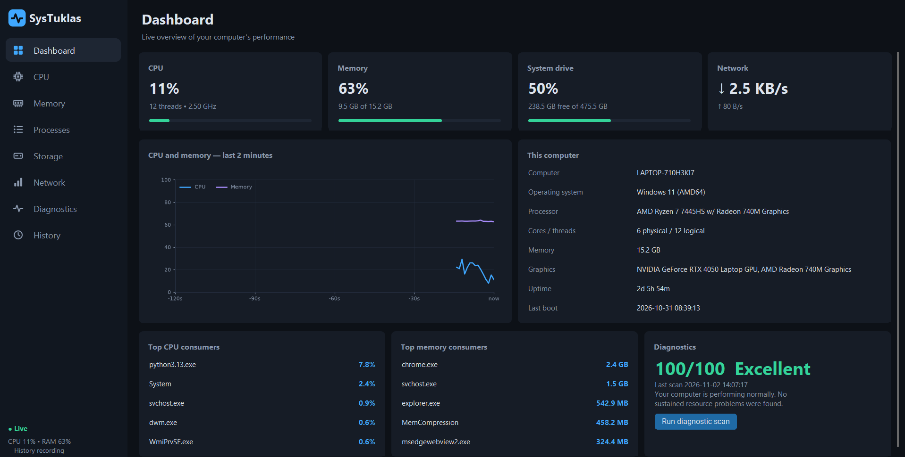
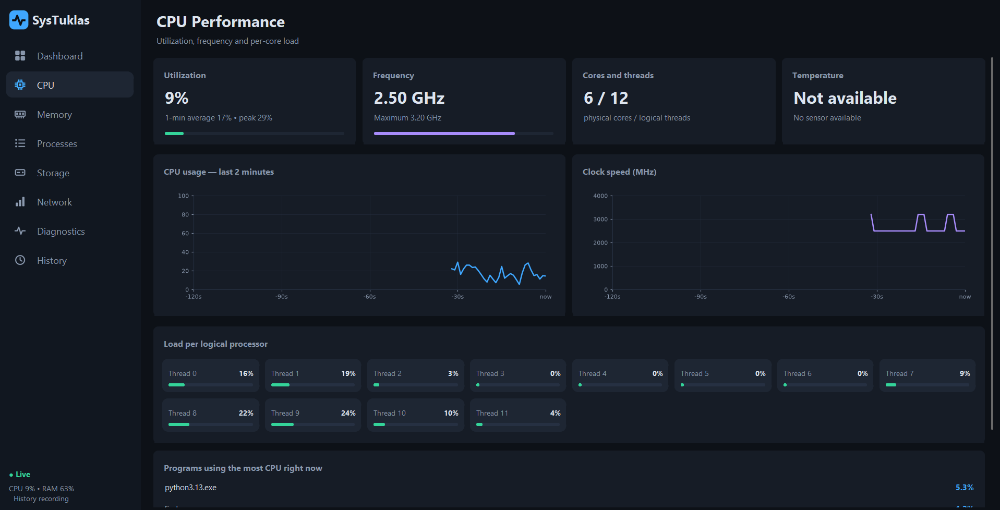

# SysTuklas

**Computer Performance Monitoring and Diagnostic Tool**

SysTuklas is a Python-based desktop application designed to monitor, analyze, and diagnose computer performance. It provides real-time system information and easy-to-understand diagnostic suggestions to help users identify potential performance issues.





## Features

| Module | Description |
|---|---|
| **Dashboard** | Displays CPU, RAM, disk, GPU, network, and system uptime. |
| **CPU Monitoring** | Tracks processor usage and performance. |
| **Memory Monitoring** | Analyzes RAM usage and availability. |
| **Process Manager** | Displays running processes and their resource consumption. |
| **Storage Analysis** | Monitors disk usage and available storage. |
| **Network Monitoring** | Provides information about network activity. |
| **Diagnostic Engine** | Identifies potential performance issues and provides suggestions. |
| **Performance History** | Stores system monitoring records using SQLite. |
| **Reports** | Exports performance data into CSV and PDF formats. |

## Tech Stack

- **Python** – Core programming language
- **CustomTkinter** – Graphical user interface
- **psutil** – System and process monitoring
- **SQLite** – Database and performance history
- **Matplotlib** – Performance charts and visualizations
- **Pillow** – Image and interface assets
- **WMI** – Optional Windows hardware information

## Requirements

- Windows 10 or Windows 11
- Python 3.9 or newer

## Installation

1. Clone the repository:

   ```bash
   git clone https://github.com/<your-username>/systuklas.git
   ```

2. Open the project folder:

   ```bash
   cd systuklas
   ```

3. Install the required dependencies:

   ```bash
   pip install -r requirements.txt
   ```

4. Run the application:

   ```bash
   python main.py
   ```

## Project Structure

```text
SysTuklas/
├── main.py
├── requirements.txt
├── database/
├── ui/
├── core/
├── assets/
└── utils/
```

## Purpose

SysTuklas aims to make computer performance monitoring more accessible by presenting technical system information through a simple interface and understandable diagnostic recommendations.

## Author

**Joshua Arao**  
Computer Science Student  
University of Science and Technology of Southern Philippines
